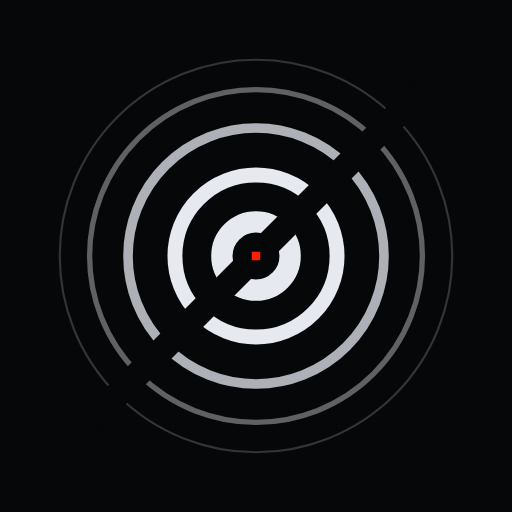

<p align="center"></p>

<h1 align="center">OI:LOOP</h1>
<p align="center"><i>Weights in Light. Compute in Motion.</i></p>
<p align="center"><a href="https://oiloop.com">oiloop.com</a> · <a href="https://oiloop.com/llms.txt">llms.txt</a> · <a href="mailto:info@oiloop.com">info@oiloop.com</a></p>

---

**OI:LOOP (Optical Integration Loop)** prints the weights of AI models into passive optical processors and sells low-cost inference tokens from its own facility. One pass of 1550 nm light performs every multiplication of a matrix at once; the weight bank itself draws 0 W.

This repository holds the public website and the public **MCP server**.

## Connect your AI assistant (MCP)

| | |
|---|---|
| Endpoint | `https://oiloop.com/mcp` |
| Transport | Streamable HTTP (stateless JSON-RPC) |
| Auth | none (public, read-only except `join_waitlist`) |

Tools: `about_oiloop`, `explain_technology`, `get_energy_comparison`, `get_facility_projection(year)`, `join_waitlist(email, name?, company?, use_case?)`

Claude: Settings → Connectors → Add custom connector → paste the URL.
Other clients:

```json
{ "mcpServers": { "oiloop": { "url": "https://oiloop.com/mcp" } } }
```

## Repository layout

```
site/   static website (index.html, llms.txt, robots.txt, sitemap.xml, icons)
mcp/    mcp.php (PHP 7.2+ MCP server), mcp-card.json, .htaccess (routes /mcp)
brand/  emblem files
```

## Deploy (shared hosting)

Copy `site/*` and `mcp/*` (including `.htaccess`) into the web root (`public_html`). The waitlist is stored in `../private/waitlist.csv`, outside the web root.

## Status

Early stage. Architecture, material, energy model and accuracy simulation are done; nothing has been fabricated yet. All performance figures are design targets or models, not measurements.

## Licence

Code (`mcp/`, site scripts): MIT, see [LICENSE](LICENSE).
The OI:LOOP name, emblem and brand assets (`brand/`, images) are not covered by the MIT licence. All rights reserved.
